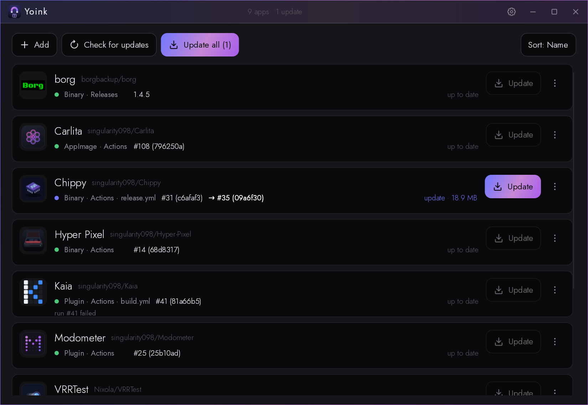

# Yoink

**An ad-hoc package manager for apps, plugins and APKs published on GitHub.**

Add an app by its GitHub repository and Yoink fetches its newest build, from
**Releases** or from **Actions** (dev builds), and puts it where it belongs.
It runs on Linux (Rust, with a [Slint](https://slint.dev) interface) and on
Android (Kotlin and Jetpack Compose), in
[Chippy](https://github.com/singularity098/Chippy)'s dark style.



## Features

- **Releases or Actions.** Follow tagged releases, pre-releases or the
  newest CI run of any workflow and branch.
- **It picks the right file.** Yoink lists what a release offers and picks
  the likeliest build for your computer. The file you pick becomes a pattern
  with its version numbers replaced by `*`, so later versions match.
- **You see the plan first.** Nothing changes until you click **Apply**.
- **No root needed.** Everything goes into folders in your home directory.
- **Updates and removals are exact.** Yoink records every file it puts in
  place.
- **Yoink updates itself**, as one of your apps.

## What it installs

| Kind | Where it goes |
| --- | --- |
| **AppImage** | Your AppImages folder (`~/Applications`). An AppImage inside a zip is unpacked and the zip discarded. The previous version is replaced. |
| **Binary** | A lone executable goes to your bin folder (`~/.local/bin`). A package laid out as `bin/`, `lib/`, `share/` is spread over your bin, lib and share folders. The archive is kept in the packages folder, one subfolder per app (unless you turn that off). |
| **Plugin** | `.vst3`, `.lv2` and `.clap` plugins go to their own folders, replacing older versions. VST2 plugins are plain `.so` files, so you pick which ones once, at the first install. |
| **APK** | Saved to your APK folder for syncing to your phone, replacing the previous one. Installing it on the phone is up to you, or to Yoink for Android. |

Archives can be zip, tar (gz, xz, zst, bz2) or 7z. AppImages and binaries
can also get a `.desktop` entry: the one inside the AppImage, pointed at
where it was delivered, or one Yoink writes.

One app can have **several deployments**, for example a plugin and its
standalone build, or a desktop app and its Android APK, each from Releases
or Actions.

## How updating works

1. **Check for updates** (F5), then **Update all**, or **Update** one app.
2. Yoink downloads the builds into a cache, checks their SHA-256 (when the
   release publishes one), unpacks them and looks inside.
3. It shows a plan listing every file that will be downloaded, copied,
   replaced, kept or deleted. If a file Yoink didn't put there (or one that
   belongs to another app) would be overwritten, the plan flags it.
4. Only **Apply** changes anything.

**Force update** in an app's ⋮ menu reinstalls the current build.

### Actions builds

Pick a workflow (or *Any*) and a branch (or the default one). Yoink takes
the newest run that has your file:

- If a run is still going but your file is already uploaded (say the Linux
  build finished while Windows is still compiling), Yoink uses it.
- If your file isn't uploaded yet, Yoink uses the previous run and tells you
  a newer build is on its way.
- A cancelled run still offers the files its finished jobs uploaded.
- Failed runs are skipped unless you allow them in Options.

GitHub only allows Actions builds to be downloaded with a token (see below).

## Using it

- **Add** an app: type `owner/name` or paste the repository's URL, then
  pick the file.
- **Icons**: Yoink looks in the repository for an icon (preferring a square
  one) and falls back to the owner's avatar. An AppImage's own icon
  replaces it at the first update. In the app's edit dialog, *Choose…* uses
  an image of your own, *From repo* fetches the repository's icon again,
  and *Follow the repo* keeps it in step with the repository.
- **Sort** the list by date added, name, last updated, updates first or
  repository, optionally reversed. Yoink remembers your choice.
- **Remove** an app: delete everything it put in place (you see the list
  first), or just stop managing it.
- **Options** (the gear, or `,`) slide out from the right:
  - **GitHub**: your token.
  - **Folders**: where each kind of package goes.
  - **Updates**: check when Yoink starts, use builds from failed runs.
  - **Look**: the theme (Iris, Ember, Abyss, Phosphor, Synthwave, Gold
    Leaf, Aurora, Blood Moon, Glacier, Graphite or Oxide), opening Options by
    resting the mouse on the window's edge, and native Wayland.
  - **Yoink**: the version, and adding Yoink to your apps.

### The GitHub token

Without a token, GitHub allows 60 requests an hour and no Actions
downloads. A **fine-grained token** with read access to *Contents* and
*Actions* is enough. For public repositories only, a **classic token with no
scopes** works too.

Yoink stores the token in your desktop's keyring (Secret Service). Where
there is no keyring, it uses `~/.config/yoink/token`, readable only by you.

Any program running as you can read an unlocked keyring, so give Yoink a
token that would be worth little to anyone else. Options warns when a token
can do more than Yoink needs:

- A warning about read access (a fine-grained token that can see private
  repositories, or classic `read:` scopes) can be dismissed. It comes back
  if you save a different token.
- A warning about write access stays.

GitHub doesn't say what a fine-grained token may write, so check yourself
that yours is read-only.

### Yoink updating itself

Add `singularity098/Yoink` as an app (or use Options → Yoink → *Add Yoink to
your apps*) and pick `yoink-x86_64-linux`, from Releases or Actions builds.

It is installed as `yoink` in your bin folder, checked and updated with
everything else, and installed last. When it has been updated, **Restart
Yoink** appears in the toolbar. Replacing the running executable is safe.

The deployment's *Desktop entry* setting works like any other app's:
`yoink.desktop` and `yoink.svg` go to your desktop entries and icons
folders and are removed with it.

### Desktop entries in a synced folder (KDE Plasma)

Desktops only look for apps in `~/.local/share/applications` and the
system's folders. To keep your desktop entries in a synced folder instead:

1. Set the desktop entries folder to an `applications` folder anywhere, for
   example `~/Sync/Yoink/applications`.
2. Turn on Options → Folders → *Show these desktop entries in KDE Plasma*.

Yoink then writes `~/.config/plasma-workspace/env/yoink.sh`, which Plasma
runs at login, to add the folder's parent (`~/Sync/Yoink`) to the front of
`XDG_DATA_DIRS`. It takes effect from the next login.

The script belongs to the computer, not to the synced settings, so turn it
on once on each computer. If the desktop entries folder changes, Yoink
updates the script to match.

## Command line

```
yoink                                   open the window
yoink --probe OWNER/REPO [releases|pre|actions[:BRANCH]] [PATTERN]
yoink --inspect FILE
yoink --plasma-status | --install-plasma-env | --remove-plasma-env
yoink --version | --help
```

- `--probe` shows what a repository offers and which build a pattern would
  install, without downloading anything.
- `--inspect` shows what Yoink finds inside a package.
- The `--…-plasma-…` options manage the KDE Plasma script described above.

Environment variables:

| Variable | Effect |
| --- | --- |
| `YOINK_HOME` | Keep the settings, library and cache in this folder. |
| `YOINK_WAYLAND` | `1` for native Wayland, `0` for XWayland. |
| `SLINT_BACKEND` | For example `winit-software` when OpenGL isn't available. |

## Files

| Path | Contents |
| --- | --- |
| `~/.config/yoink/settings.toml` | Settings |
| `~/.local/share/yoink/library.json` | Your apps, their deployments and what each one installed |
| `~/.cache/yoink/staging` | Downloads waiting for a plan to be applied |

## Building

```bash
cargo build --release
```

You need Rust 1.88 or newer and the fontconfig and xkbcommon development
packages (on Debian and Ubuntu, `libfontconfig-dev` and
`libxkbcommon-dev`). Skia renders by default; build with
`--no-default-features` to use femtovg instead.

```bash
cargo test
```

CI builds `yoink-x86_64-linux` on Ubuntu 22.04, so it runs on distributions
with glibc 2.35 or newer.

## Android

`android/` holds Yoink for Android: a smaller Yoink, in the same look and
themes, that deals only in APKs and installs them itself.

- **Add** an app from Releases, pre-releases or Actions builds, as on the
  desktop. Yoink picks the APK for the phone's processor (`arm64-v8a`,
  `armeabi-v7a`, `x86_64`…, or a universal one). APKs inside zips (Actions
  artifacts, or zipped releases) are taken out.
- **Check for updates** (the refresh button, or pull down), **Update**,
  **Update all** and **Force update**. Yoink shows what it will download,
  checks the SHA-256 when the release publishes one, then hands the APK to
  Android's package installer.
- Android asks you to confirm the first install. On Android 12 and newer,
  updates of apps Yoink installed go through without asking. Android refuses
  an older version, or an APK signed with a different key than the
  installed app.
- **Remove** an app: uninstall it (Android asks), or just stop managing it.
- **Options**: the GitHub token (encrypted with a key in the Android
  Keystore), allowing failed Actions runs, the *Install unknown apps*
  permission, the APK folder, and the theme.
- **APK folder**: pick any folder (shared storage, an SD card, a synced or
  cloud folder) and Yoink also saves each APK it installs there, replacing
  that app's previous one. If saving fails, the install still goes ahead.
- **Yoink updating itself**: add `singularity098/Yoink` and pick
  `Yoink-<version>.apk`, from Releases or Actions builds.

Needs Android 8 or newer. Split APK bundles (`.apks`, `.xapk`) aren't
supported.

### Building for Android

```bash
cd android
```

```bash
./gradlew assembleRelease
```

```bash
./gradlew testDebugUnitTest
```

The APK is written to `app/build/outputs/apk/release/Yoink-<version>.apk`: the
crate's version and the commit, as in `Yoink-0.1.0-3eeaca9.apk`.
You need JDK 17 or newer and the Android SDK (platform 36), found through
`ANDROID_HOME` or `local.properties`.

### Signing

A release build is signed with the keystore named by `YOINK_KEYSTORE`, with
`YOINK_KEYSTORE_PASSWORD`, `YOINK_KEY_ALIAS` and `YOINK_KEY_PASSWORD`.

Without those, every build is signed with `android/yoink-dev.keystore`
(password `yoink-dev`). It is kept in the repository so every build, local
or from CI, has the same signature and installs over the previous one. CI
numbers each build's `versionCode` by run; local builds use 1.

The dev key is public, so anyone could sign an APK that Android would
accept as an update of a dev-signed Yoink. To have CI sign with a private
key, add these repository secrets:

- `ANDROID_KEYSTORE_BASE64`: the keystore, from `base64 -w0 yoink.jks`
- `ANDROID_KEYSTORE_PASSWORD`
- `ANDROID_KEY_ALIAS`
- `ANDROID_KEY_PASSWORD`

Make the keystore once and keep it safe:

```bash
keytool -genkeypair -keystore yoink.jks -alias yoink -keyalg RSA -keysize 4096 -validity 10000
```

Switching keys means uninstalling Yoink once, because Android refuses an
update signed with a different key.

## Licence

GPL-3.0-or-later. The look, the icons and the Jost font (SIL Open Font
Licence) come from Chippy.
